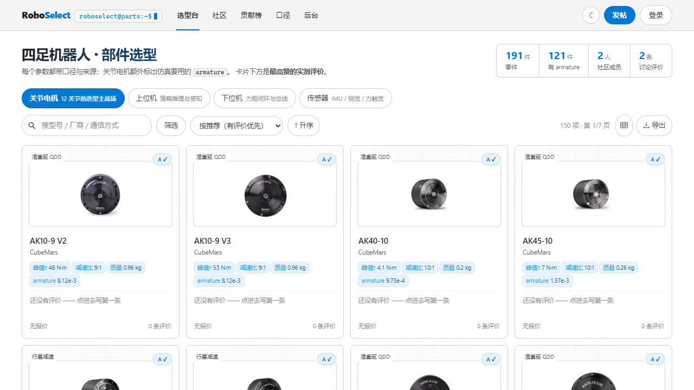
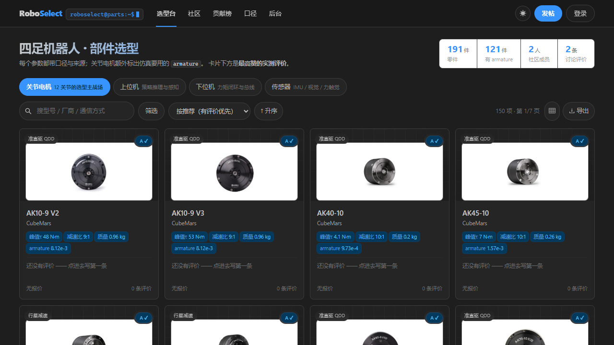
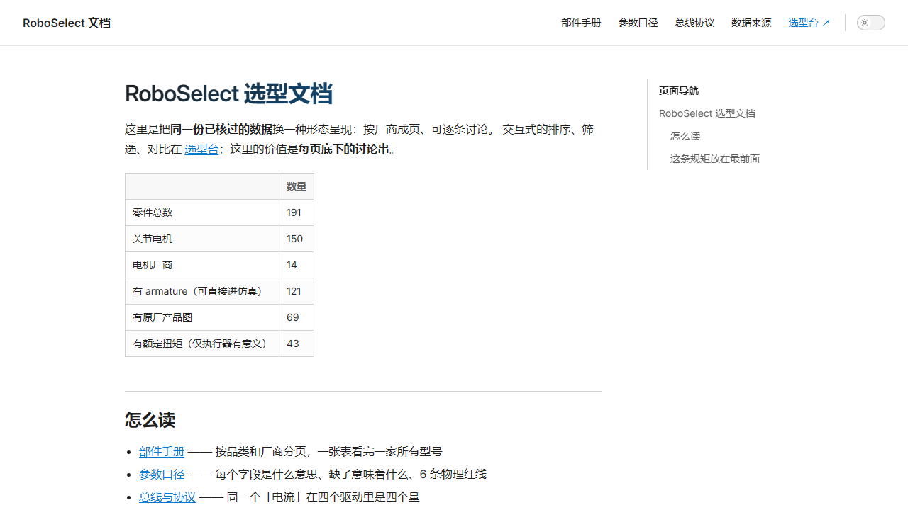
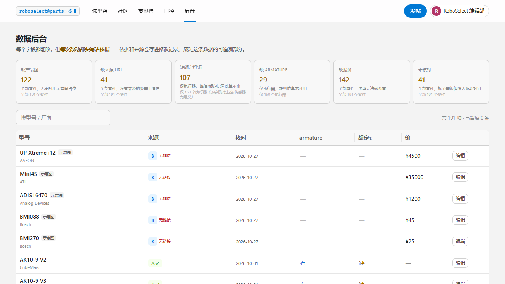

# RoboSelect

**四足机器人选型 + 真实使用社区。**

> **线上**：<https://zeitvex.github.io/roboselect/> —— 文档站（VitePress，纯静态）。
> 选型台与社区需要 Python 托管环境，本地 `uvicorn` 起来即完整。原因见 §4.1。

选型台是底座，社区是主体。零件参数带口径、可校验、能导出到仿真；评价来自真装机，
挂在零件上，同一套内容既出现在社区信息流，也出现在零件详情页。

```
backend/   FastAPI + SQLModel（Python 3.12）
frontend/  React 19 + antd 6 + Tailwind 4 + TanStack Query（Vite）
wiki/      VitePress 文档站（内容由 data/ 生成，每页一条讨论串）
data/      191 个零件，全部带来源等级与口径
docs/      参考项目评估 + 截图
scripts/   数据生成、闸门、文档生成
```

> 参考的上游项目（InvenTree / Directus / NodeBB / Answer / antd-pro / fastapi-template /
> sqlmodel / refine / giscus）浅克隆在仓库外的 `../_refs/`，不参与运行。

| 选型台（浅色） | 选型台（深色） |
|---|---|
|  |  |
| **文档站** | **数据后台** |
|  |  |

### 明暗切换

顶栏右侧圆形按钮（☾ / ☀）。状态存 `localStorage`，没存过就跟随
`prefers-color-scheme`，系统变化也会跟（除非手动选过）。

实现方式决定了成本：Tailwind v4 的工具类输出的是
`color: var(--color-slate-500)` 这种**引用**，所以在 `[data-theme="dark"]` 里
换掉变量，200 多处既有类名一起变，组件一处都不用改。
代价是**不能有写死的颜色** —— 踩过两次：`bg-white`（literal white）和
示意图里的内联 `hsl()`，都改成变量了。详见 [ref-zeitvex.md](docs/ref-zeitvex.md)。

文档站的明暗由 VitePress 自带（`appearance: true`），深色版对齐 VS Code dark，
giscus iframe 通过 `postMessage` 跟着切。

### 一件必须先说清的事：社区里没有假评价

种子里**一条用户评价都没有**。曾经灌过 21 条「实测」，全是我编的——技术观察是真的，
但「跑了三个月」「外壳 62℃」「背隙 ±0.05°」这些数字是编的，作者也是虚构的。
在一个立意是「真实使用信息」的站里，这比空着坏得多，已全部删除。

现在社区里只有 **2 条站方署名的编者按**（`RoboSelect 编辑部`），且强制满足：
不带 `rating`、不声称 `own_hardware`、标题以「编者按：」开头、每句话都能指回目录数据。
`tests/test_api.py::test_feed_has_seeded_posts` 会把这条规则钉死。

### 卡片上的四件事

1. **它长什么样** —— 厂商原厂产品图（69/147 有），没有图的用**按真实 `OD/L` 画的示意图**并标「示意图」；
2. **核心参数** —— 峰值扭矩 / 减速比 / 质量 / `armature` 四个 chip；
3. **最高赞评价** —— 有就显示原文摘录 + 作者 + ▲票数，没有就写「还没有评价」，不编；
4. **能不能信** —— 来源等级徽标（A/B/C）+ 是否核对过 + 核对日期。

---

## 1. 为什么是「社区 + 选型台」而不是一个零件表

选四足关节电机时最贵的错误不是买到差件，是**参数不可比**：

- 同一批 700+ 条数据里，扭矩字段出现过 **19 种**表述、转速 **37 种**，其中 `6.3 rad/s`
  与 `0.222 sec/60°` 量纲互逆，按数值排序会得到完全相反的结论；
- 「峰值扭矩」不给持续时间和初始温度就没有工程意义，峰值/额定常差 3–5 倍；
- 厂商给的「等效惯量」有的是电机侧、有的是输出侧，**读错这一位，MuJoCo 的 `armature` 会错到 10⁴ 倍**。

这些都只能靠**制度 + 真实反馈**解决，不能靠规格表。所以：

- **制度**：每条参数带口径、带来源等级、缺口显式留空，机器可校验（`scripts/check_data.py`）；
- **反馈**：任何人都能对某个零件写评价、对别人的说法投票，**实测优先**。

## 2. 社区的数据模型（只有一套）

「评价」不是独立表，而是**挂在零件上的帖子**：

```
Post.kind = discussion | review | build
  discussion  讨论：问题、方法论、踩坑             part_id 可空
  review      评价：真实使用反馈，必带 rating 与 part_id
  build       整机方案：一台四足的 BOM 与取舍       part_id 可空
```

于是社区 feed、零件详情页的评价区、个人主页共用同一套 Post / Comment / Vote，
只差 `kind` 与 `part_id`。少一套机制，少一处漂移。

| 表 | 作用 |
|---|---|
| `parts` | 目录（只由种子灌入，用户不可改） |
| `offers` | 优惠 / 赞助位（`part_id` 可空 = 全站） |
| `users` | 账号、声望（收到的赞之和，冗余字段） |
| `posts` | 帖子（含评价与整机方案） |
| `comments` | 评论，**只支持两级**（父 + 回复） |
| `votes` | `(user, target_kind, target_id)` 唯一，值 ±1 |

**票数与声望永远从 `votes` 表重新聚合**，不做增量加减 —— 增量在并发下会漂。

徽章是派生的，不落库：首次发帖 / 常驻作者 / 热心回复 / 实测派 / 方案作者 / 百赞 / 千赞 / 站务。

## 3. 参数口径纪律

`scripts/check_data.py` 在灌库前拦住这些：

| 规则 | 为什么 |
|---|---|
| 同 subtype 键集完全同构，缺失写 `null` | 「没测」和「测出 0」必须能区分 |
| `tau_basis: peak \| rated` 必填 | 行业里扭矩有 19 种口径 |
| `rotor_inertia` 与 `inertia_basis` 同时给或同时空 | 读错会让 armature 错 10⁴ 倍 |
| **`armature == N²·J` 逐行复算** | 闸门实测抓出过 25 行不一致 |
| 物理量程（电感 1–20000 µH 等） | 抓出过把 `0.211 mH` 当 `0.211 µH`、以及 `μ`/`µ` 两码点导致的 ×10⁶ |
| 扭矩密度 >120 需复核、>200 不可信；峰值/额定 >3 需给持续时间 | 行业「参数虚标」判据 |

派生量（扭矩密度、峰值/额定、ω_NL、峰值功率、包络体积、armature 复算）**在读取时计算，不落库**。

## 3.1 产品图从哪来

```
scripts/extract_images.py   本地厂商 PDF → 按版面几何挑产品照（达妙手册 / 灵足规格书，38 张）
scripts/fetch_images.py     厂商产品页 og:image + 在线 PDF → 抓（CubeMars / MyActuator …）
scripts/reconcile_images.py 已经落盘的图按文件名反查回零件 id（抓取中断时用）
```

产物：`frontend/public/parts/*.{jpg,png}` + `data/part_images*.json` 映射。
当前 **69/147 有原厂图，76 张 / 4.3 MB**。没图的件前端画示意图并标「示意图」，不留空。

> 图是从厂商公开的选型手册/产品页取的，用于识别零件。**不做二次分发承诺**——
> 若要商用请回到厂商授权。

## 3.2 后台：每个字段都能改，但必须留痕

`/admin`（需 `is_staff`）——数据缺口看板 + 逐字段编辑：

| 缺口 | 当前 |
|---|---|
| 缺产品图 | 119 |
| 缺来源 URL | 41 |
| 缺额定扭矩 | 148 |
| 缺 armature | 67 |
| 缺报价 | 139 |
| 未核对 | 41 |

改任何字段都要填 **依据** 与 **来源链接**，写入 `part_edits` 表（字段 / 旧值 / 新值 / 依据 / 谁改的 / 何时），
`last_checked` 自动更新。于是任何一个数字都能回答：
**它什么时候、被谁、凭什么被改成了现在这样**。

### 看板自己的口径

缺口统计必须**只在字段有意义的品类里算**。曾经把 `tau_rated_Nm` 缺额算成 148
（全库减已有的），虚增了 41 个——主控和传感器根本没有这个字段：

| 缺口 | 正确 | 曾经算错 | 分母 |
|---|---|---|---|
| 缺额定扭矩 | **107** | ~~148~~ | 147 个执行器 |
| 缺 armature | **26** | ~~67~~ | 147 个执行器 |
| 缺产品图 | 119 | 119 | 全部 188 个零件 |
| 缺来源 URL | 41 | 41 | 全部 188 个零件 |
| 缺报价 | 139 | 139 | 全部 188 个零件 |
| 未核对 | 41 | 41 | 全部 188 个零件 |

`tests/test_admin.py` 把这条钉死了：**看板上的数字必须等于点进去筛出来的条数**，
且 `no_rated_torque <= actuators`。

> 额定扭矩只有两家有真值：达妙 31 行、灵足 9 行（都是我亲手解析的选型表/规格书）。
> 其余 107 个执行器缺，是因为 Draft 的原始目录只记了 `tau_peak_Nm`，
> **从来没有额定扭矩这个字段**。

## 4. 跑起来

```bash
# 后端（API + 选型台 + 文档站都由它托管）
cd backend
pip install -r requirements.txt
uvicorn app.main:app --reload --port 8000
# → API 文档 http://127.0.0.1:8000/api/docs

# 前端（开发模式，带热更）
cd frontend
npm install
npm run dev            # http://localhost:5173，/api 代理到 8000

# 生产：构建后由后端一同服务
cd frontend && npm run build
# 之后直接访问 http://127.0.0.1:8000/

# 文档站（VitePress）：内容由数据生成，数据变了要重跑
python scripts/build_wiki.py
cd wiki && npm install && npm run build
# → http://127.0.0.1:8000/wiki/
```

两个前端，两种形态，同一份数据与同一套账号：

| | 选型台 `/` | 文档站 `/wiki/` |
|---|---|---|
| 适合 | 比较、排序、筛条件 | 从头读、按厂商查、看口径 |
| 互动 | 零件抽屉 + 社区信息流 | **每页底下一条讨论串** |
| 登录 | 选型台右上角（localStorage 同源共享，文档站直接能发言） |

演示账号：`roboselect`（站务）/ `demo1`，密码都是 `roboselect`。

环境变量（`ROBOSELECT_` 前缀）：

| 变量 | 默认 | 说明 |
|---|---|---|
| `ROBOSELECT_DB_PATH` | `roboselect.db` | SQLite 位置 |
| `ROBOSELECT_SECRET_KEY` | `dev-only-change-me` | **生产必须覆盖**（≥32 字节） |
| `ROBOSELECT_CORS_ORIGINS` | 本地 5173/8000 | JSON 数组 |

### 4.1 GitHub Pages 部署了什么、没部署什么

仓库：<https://github.com/zeitvex/roboselect>（原名 `roboselect.github.io`，已改名）
线上：<https://zeitvex.github.io/roboselect/>

仓库名不是 `<user>.github.io`，所以是 **project site**，站点挂在 `/roboselect/` 下，
不是根域名。`wiki/docs/.vitepress/config.mts` 用 `WIKI_BASE` 环境变量切换 base，
工作流里设成 `/roboselect/`，本地默认仍是 `/wiki/`。

| | Pages 上 | 为什么 |
|---|---|---|
| 文档站 `/wiki` | ✅ 已部署 | VitePress 是纯静态产物 |
| 选型台 `/` | ❌ | 需要 FastAPI + SQLite（排序、检索、登录都走 API） |
| 社区 / 后台 / MCP | ❌ | 全部要写库 |

文档站在无后端时会显示一句提示（「静态预览：讨论需要后端」），
而不是抛红错——见 `PageComments.vue` 的 `offline` 分支。
想线上也能发言，两条路：填 `wiki/docs/.vitepress/giscus.ts` 用 GitHub Discussions，
或把 FastAPI 部署到能带磁盘的地方（Fly.io / Railway / 一台 VPS）。

## 5. API

| 方法 | 路径 | 说明 |
|---|---|---|
| GET | `/api/catalog?category=` | 分类/子类/厂商（**厂商按分类收窄**） |
| GET | `/api/parts` | `category` `subtype` `vendor` `q` `sort` `order` `limit` `offset` `has_armature` `in_stock` |
| GET | `/api/parts/{id}` | 单件 + 派生量 + 优惠 + **该件的帖子** |
| GET | `/api/posts` | `kind` `part_id` `author` `tag` `q` `sort=new\|hot\|top` |
| POST | `/api/posts` | 发帖（评价必须带 `part_id` 与 `rating`） |
| GET | `/api/posts/{id}` | 帖子详情（阅读数 +1） |
| GET/POST | `/api/posts/{id}/comments` | 两级评论 |
| POST | `/api/votes` | `{target_kind, target_id, value}`，`value=0` 撤销 |
| GET | `/api/users/{handle}` · `/api/leaderboard` | 个人页 · 贡献榜 |
| POST | `/api/auth/register` · `/login` · GET `/me` | JWT（PBKDF2 口令哈希） |
| GET | `/api/export/draft` | Draft `actuators.yaml` + MuJoCo `armature` 表 |
| GET | `/api/semantics` | **参数口径规范（机读版）**：字段语义、6 条物理红线、单位换算、可比性分级、问询清单 |
| GET | `/api/protocols` · `/{id}` | **总线与协议口径**：电流编码与满量程、协议减速比 vs 名义值、控制模式、固件差异（带证据） |
| GET/POST | `/api/wiki/comments` · `DELETE /{id}` | **文档页讨论串**：按 footer 路径索引的树形线程（`parent_id` 一层回复） |
| GET | `/api/wiki/comment-counts` | 每页讨论条数 |
| GET | `/mcp` · POST `/mcp` | **MCP 端点**：`search_components` / `get_component_detail` / `compare_components` / `get_parameter_semantics`，JSON-RPC 2.0，只读免鉴权 |

排序字段走白名单；`NULL` 在升/降序下都排最后。

### MCP：让 AI Agent 直接查

```bash
curl http://127.0.0.1:8000/mcp            # 工具清单
curl -X POST http://127.0.0.1:8000/mcp -H 'Content-Type: application/json' \
  -d '{"jsonrpc":"2.0","id":1,"method":"tools/call",
       "params":{"name":"search_components","arguments":{"q":"J4340","limit":3}}}'
```

形态参考 [roboparts.cc/mcp](https://roboparts.cc/mcp)：只读、免鉴权、不设 cookie。
刻意不给写操作——**Agent 可以查、可以比，不能替你发帖或投票**。

## 6. 测试

```bash
cd backend && python -m pytest -q      # 21 项
cd frontend && npx tsc -b              # 类型检查（build 也会跑）
python scripts/check_data.py           # 数据闸门
```

覆盖：目录分页/厂商收窄/null 排序/排序注入退化、**armature == N²·J 全量不变量**、
注册登录去重、发帖校验（评价缺零件/缺评分/非法 kind）、投票计分与撤销、
**两级评论限制**、评论计数、声望排序、导出、**SPA 深链回退**。

## 7. 已知边界

- **主控与传感器的精度低于执行器**：执行器逐项来自官方选型表/规格书（A 级），
  主控与传感器多为 B 级（公开值未逐项复核）。
- **没有整机反解**：「给负载与预算反解一套件」还没做。
- **热度排序是简化口径**（互动量优先），没有时间衰减权重。
- **限流是进程内的**，多副本部署要换 Redis。
- **没有通知 / 关注 / 收藏 / 举报**，社区长起来之前不需要。
- **力矩-转速包络不在 MJCF 里**：导出的是 `actuatorfrcrange` + `velocity_limit` 两个独立数，
  线性包络要控制器侧实现。

## 8. 资料

- [`docs/ref-zeitvex.md`](docs/ref-zeitvex.md) —— **视觉系统**：VS Code 2026 风
  （`#f3f3f3` 中性灰 + `#0078d4` + 8px 圆角），终端药丸品牌标、分段统计条、浅蓝标签
- [`docs/ref-yunqiandoc.md`](docs/ref-yunqiandoc.md) —— **云嵌战队文档**：VitePress 形态、
  giscus 的 `mapping: pathname`、为什么改成自托管
- [`docs/ref-ustc-robowalker.md`](docs/ref-ustc-robowalker.md) —— **中科大电控教程**：
  协议口径（同一个「电流」是四个不同的量）、M3508 真实减速比 3591/187、达妙固件坑
- [`docs/ref-zju-wiki.md`](docs/ref-zju-wiki.md) —— **浙大 HelloWorld 战队 Wiki**：11 份厂商手册、
  电机抽象、3 个新增 RoboMaster 件、2 处来源冲突
- [`docs/ecosystem.md`](docs/ecosystem.md) —— 国际 / 中文 / 开源生态的调研与借鉴清单
- [`docs/references.md`](docs/references.md) —— 用了哪些上游项目、哪些只借设计
- [`docs/screenshot-*.png`](docs/) —— 截图

### 从生态里抄来的三件事（已落地）

| 来源 | 借的东西 | 落地 |
|---|---|---|
| **RoboParts** MCP | 口径规范做成工具、三态 `yes/no/unknown`、`null ≠ 不兼容` | `/api/semantics` + `/mcp` + `/semantics` 页 |
| **LeRobotDepot** | 整机报价必须 **数字 + 覆盖范围 + 是否核实** 三件套 | `build` 帖的 `total_price_cny` / `price_scope` / `price_verified`，有报价没范围直接 422 |
| **Humanoid Atlas** | 受控枚举 + 投稿流程 | `kind` / `use_case` 枚举校验（成对 Elo 榜待做） |
