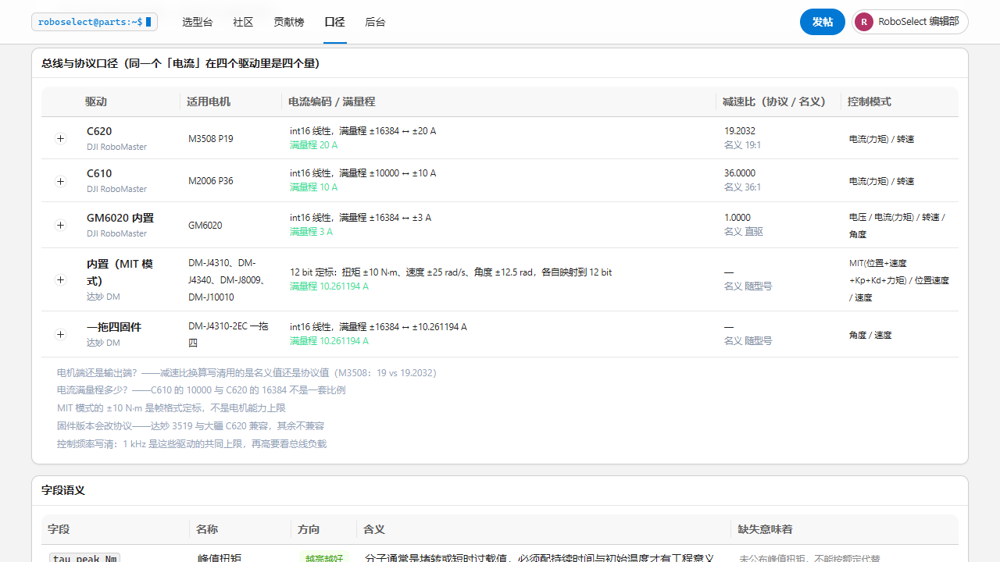

# 参考项目：yssickjgd/robowalker_train（中科大电控教程）

- 仓库：<https://github.com/yssickjgd/robowalker_train>（中科大 yssickjgd）
- 镜像：<https://git.ustc.edu.cn/yssickjgd/robowalker_train>（校内 GitLab）
- 配套视频：<https://space.bilibili.com/337732684/lists/1043942>
- 本地副本：`_refs/robowalker/`（浅克隆，59,453 个文件）
- 最近提交：`ef5a806 修改 readme.md 中的链接和格式，新增Kalman滤波器的推导过程课时`

中科大 RoboMaster 战队的**电控教学仓库**：STM32 从 GPIO 一路教到多电机 PID、底盘功率控制、云台。

---

## 1. 它是什么，不是什么

**是**：一套完整的 STM32 电控课程 + 每章可编译的 Keil/CubeMX 工程。
`01_electrical/03_motor_control/` 有 12 章递进（CAN → DJI 电机 → PID → 前馈 PID → 多电机 →
**达妙电机控制** → 大疆电机进阶），`05_chassis/` 有功率模型与功率重分配。

**不是**：硬件参数数据库。厂商手册它没有，参数也不成表。
**它的独有价值在于「协议口径」** —— 也就是「代码里那个 int16 到底代表多少安培」。

## 2. 最大的收获：同一个「电流」是四个不同的量

从 `dvc_motor_dji.h` / `dvc_motor_dm.h` 的定标常量反推出来：

| 驱动 | 电流编码 | 满量程 | 减速比（协议 / 名义） |
|---|---|---|---|
| DJI C620（M3508） | `16384/20` | ±20 A | **19.2032** / 19:1 |
| DJI C610（M2006） | `10000/10` | ±10 A | 36.0 / 36:1 |
| GM6020 内置 | `16384/3` | ±3 A | 直驱 |
| 达妙 MIT | 12 bit 定标 | ±10.261194 A | 随型号 |
| 达妙一拖四 | `16384/10.261194` | ±10.261194 A | 随型号 |

三条能直接用的结论：

1. **C610 与 C620 的编码满量程不是一套比例**（10000 vs 16384）。
   把 C610 原始值按 C620 比例换算，会偏大 **64%**。
2. **M3508 的真实减速比是 3591/187 = 19.2032**，不是手册写的 19。
   做转速↔转子换算时用 19.0 会有 **1.06%** 系统性偏差。已把目录里该行改成 19.2032，
   名义值留在 notes 里。
3. **达妙 MIT 模式的 ±10 N·m 是帧格式定标，不是电机能力上限。**
   同理 ±12.5 rad、±25 rad/s 也是定标，不是机械限位。
   把 10 N·m 当成「这个电机最大 10 N·m」会低估 J4340（40 N·m 级）一个档。

## 3. 一个必须知道的固件坑

`03_motor_control/11_test_damiao_motor_control/20250120 关于新固件的补充告知.md`：

> 达妙 **3519 电机**的一拖四版本固件协议与**其余电机（如 4310）是不同的**。
> 3519 完全兼容大疆的 C620-3508 系列电机协议，其余电机仍遵循教程中的协议。

也就是说同一份代码在 3519 上会完全不响应。教程用的固件版本是 `5051_01`。
这条已写进 `data/protocols.json` 的 `dm-1to4` 条目。

## 4. 本轮实际补充了什么

### 4.1 新增协议口径层（产品化）

- `data/protocols.json` —— 5 条协议，每条含：总线、控制频率、电流编码与满量程、
  协议减速比 vs 名义减速比、控制模式、**证据（哪个头文件的哪一行）**
- `GET /api/protocols`、`GET /api/protocols/{id}` —— 只读免鉴权
- `/semantics` 页新增「总线与协议口径」表，可展开看每条的口径提醒与证据



### 4.2 修正一个数据

`DJI RoboMaster M3508 P19` 的 `gear`：`19.0` → **`19.203208556149733`**（3591/187）。
名义值 19:1 与协议值的关系写进 notes。这条改动有明确证据，不是猜的。

### 4.3 没有改动数据、只记录的两处

- 达妙 MIT 的 `±10 N·m` 是定标 —— 目录里 31 行达妙件仍用厂商手册的扭矩值；
  定标值放协议层，不与电机能力混在一张表里
- 达妙一拖四固件版本差异 —— 写进协议层 notes，不动零件数据

## 5. 明确没采用的

- **C++ 电控代码本身** —— 与选型/社区无交集
- **教学章节**（GPIO/EXTI/TIM/UART/ADC/CAN/PID/前馈/Kalman/欧拉角）—— 是课程不是数据
- **`05_chassis` 功率模型** —— 想抄它的「功率 = f(扭矩, 转速)」，但该章的
  `0_text/formula.md` 讲的是 Taylor 展开与最小二乘，`derivation_process.md` 讲的是旋转矩阵，
  **具体功率公式不在 markdown 里**（应在代码或视频里）。没找到就不编。
  > 这是个真缺口：RoboWiki 现在没有任何「功率/电流估算」能力，
  > 而选电池和驱动板正需要它。后续可从 `07_motor_power_model` 的 `main.c` 反推，
  > 或直接用 `P = τ·ω / η + P_铁损 + P_铜损`（需 η 与 R_phase，两者目录里大部分件都有）。

## 6. 复现

```bash
git clone --depth 1 https://github.com/yssickjgd/robowalker_train.git _refs/robowalker

# 协议常量在这些头文件里
grep -n "Current_To_Out\|Gearbox_Rate =\|Theoretical_Output" \
  _refs/robowalker/**/dvc_motor_dji.h
grep -n "__Current_Max\|__Torque_Max\|__Angle_Max\|__Omega_Max" \
  _refs/robowalker/**/dvc_motor_dm.h

# 固件坑
cat "_refs/robowalker/01_electrical/03_motor_control/11_test_damiao_motor_control/20250120 关于新固件的补充告知.md"
```

数据侧只需维护 `data/protocols.json`，端点会自动读到（模块内缓存，改完重启进程即可）。
