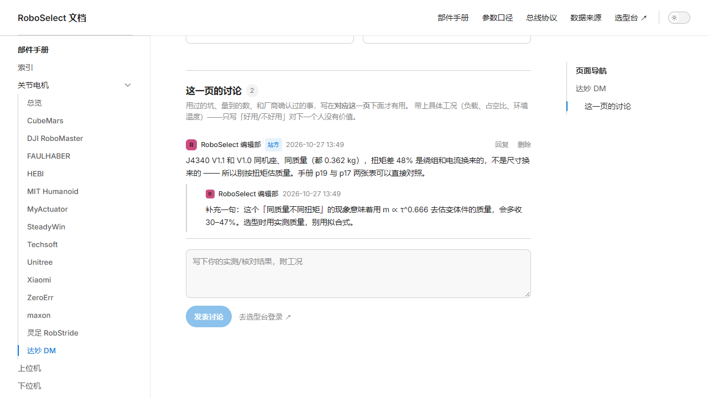

# 参考项目：euuen/YunQianDoc（云嵌战队文档）

- 仓库：<https://github.com/euuen/YunQianDoc>
- 站点形态：VitePress 文档站，部署在 GitHub Pages（`base: '/YunQianDoc/'`）
- 本地副本：`_refs/YunQianDoc/`（172 个文件，131 MB，大头是图/视频）
- 最近提交：`e712d48 修复workflow build失败的bug`

**YG 的原话：「最后创建的社区形态类似这样」。** 所以这一份不是「再抄点数据」，
而是**换形态** —— 我原来做的是「论坛式社区」（信息流 / 发帖 / 投票），
这份给的是「文档式社区」：**分层导航的知识库 + 每页底下一条讨论串**。

## 1. 它的形态

```
docs/
├── .vitepress/
│   ├── config.mts              站点配置：nav、sidebar、中文文案、base、editLink
│   ├── theme/index.ts          默认主题 + 三个插槽 + giscus 评论
│   └── components/            DocBefore（正文前导读）/ QuizAnswer / EmbededVideo / LayoutBottom（访问量）
├── ec/
│   ├── control/               14 篇控制理论（PID / 卡尔曼 / LQR / 观测器 / 陷波 / 共振…）
│   ├── math/                  8 篇数学
│   ├── matlab/                12 篇 MATLAB/Simulink
│   ├── programing/  practice/  rm/   ...
│   └── 26电控组速通赛道.md
└── index.md
```

**关键在 `theme/index.ts` 的 `setup()`：**

```ts
giscusTalk({
  repo: 'euuen/YunQianDoc', repoId: '...',
  category: 'Announcements', categoryId: '...',
  mapping: 'pathname',      // ← 用路径做页面标识
  inputPosition: 'top',
  lang: 'zh-CN',
  lightTheme: 'light', darkTheme: 'dark',
}, { frontmatter, route }, true)
```

也就是说：**每篇文档底下自动出现一条讨论串，标识用 pathname**。
读者看文档时不必「进论坛找板块」，就地能问、能答。

它还用了这些插件，都值得记一笔：
`markdown-it-mathjax3`（公式）、`vitepress-mermaid-viewer`（图）、
`vitepress-plugin-codeblocks-fold`（代码折叠）、`nprogress-v2`（切页进度条）、
`vitepress-plugin-image-preview`（图片放大）、Vercount（访问量，非 Google Analytics）。

## 2. 我照搬了什么

| 它的做法 | 本项目的落地 |
|---|---|
| VitePress + 中文文案（返回顶部 / 页面导航 / 上次更新 / 404 文案） | `wiki/` 完整照此配置 |
| 分层 sidebar（品类 → 子页） | 部件手册 → 关节电机 → 14 家厂商 → 逐家一页 |
| `mapping: pathname` 的页面标识 | `PageComments.vue` 用路径做 `page` 键 |
| 正文之后挂讨论 | `doc-after` 插槽 |
| 默认主题 + 少量 CSS 变量覆盖 | `theme/custom.css`（品牌色、深色背景、表格 nowrap） |

## 3. 我没照搬的，以及为什么

### giscus 已接好，等你填四个字段

**「注册一个 `roboselect.github.io` 仓库是不是就可以了」——基本可以，但仓库名不重要。**
必须同时做到四件事：

| # | 要求 | 在哪做 |
|---|---|---|
| 1 | 仓库是 **public** | 私有仓库 giscus 读不到 Discussions |
| 2 | 开启 **Discussions** | Settings → General → Features |
| 3 | 装 [giscus App](https://github.com/apps/giscus)，只授权这一个仓库 | Install → Only select repositories |
| 4 | 在 [giscus.app](https://giscus.app/zh-CN) 填仓库名，抄回 `repoId` / `category` / `categoryId` | 分类选 **Announcements**（只有维护者能开新帖，其他人只能评论） |

`roboselect.github.io` 这个名字完全可行，而且顺便还能直接当 GitHub Pages 站点用。

**门槛效果正是你要的**：读不需要登录，**写必须 GitHub 账号**。
顺带白拿 GitHub 的反垃圾、编辑历史、邮件通知、@提醒、以及「按 Discussion 搜索」。

实现已经写好在 `wiki/docs/.vitepress/giscus.ts` —— 把 `giscus` 常量从 `null` 换成
你那四个 id，重新 `npm run build` 就切换过去；不填则自动回落到自托管讨论串。主题跟随
深浅色切换（通过 `postMessage` 通知 iframe）。

### 但有一个代价必须先说清

giscus 的评论**存在 GitHub，不在本站数据库**。所以它：

- 不会出现在选型台的社区信息流、贡献榜、零件页的「最高赞评价」里
- 站内搜索搜不到
- 数据主权在 GitHub（导出要自己写脚本拉 GraphQL）

所以现在的取舍是**分工**：

| | 用什么 | 为什么 |
|---|---|---|
| 文档站 `/wiki` | **giscus**（要 GitHub 账号） | 门槛 + 零维护 + 反垃圾 |
| 选型台零件页、社区信息流 | **自托管** `Post` / `WikiComment` | 要能聚合、排序、算贡献、进搜索 |

### 内容 → 从数据生成，不手写

它那 40 多篇是**人写的理论课**（PID、卡尔曼、LQR），适合教学。
我这边的知识库是**数据视图**：191 个零件、14 家厂商，手写的表格第二天就过期。
所以 `scripts/build_wiki.py` 从 `data/*.json` 生成 23 个页面，
口径页直接 `import` 后端的常量（`RED_LINES`、`FIELD_SEMANTICS`…），杜绝两份文档漂移。

### 其他

- **Vercount 访问量** —— 需要外部服务，跳过（要做就自己记表）
- **QuizAnswer / EmbededVideo 组件** —— 教学专用，本项目没有课
- **`base: '/YunQianDoc/'`** —— 我用 `base: '/wiki/'`，由 FastAPI `StaticFiles` 托管，
  和选型台同一个域名，登录态（localStorage 的 token）天然共享

## 3.1 视觉：从深色改成白 + 蓝

YG 要求「整体偏白色、蓝色、浅色风」，所以两个站一起换肤：

| | 之前 | 现在 |
|---|---|---|
| 页面底 | `#0b0f16` 近黑 | `#f8fafc` |
| 卡片 | `#12161f` | `#ffffff` + `#e2e8f0` 描边 |
| 强调色 | `#3ddc97` 薄荷绿 | `#2563eb` 蓝 |
| 正文 | `white/85` 等透明度叠加 | slate 阶梯（900/600/400） |
| 技术示意图 | 深色机身 + 亮描边 | 同 hue 浅色机身（像阳极氧化铝）+ 深描边 |
| 产品照托板 | 深色卡上贴一块浅板 | 纯白板 + `mix-blend-mode: multiply`（白底无缝） |

迁移用脚本按 token 精确替换（229 处），不重写组件 —— 组件结构没变，只换了皮。
机器只能保证「没有残留的深色 token」，配色是否顺眼必须看截图。

## 4. 现在的形态

```
http://127.0.0.1:8000/          ← 选型台（React SPA，交互式排序/筛选/对比）
http://127.0.0.1:8000/wiki/     ← 文档站（VitePress，分层导航 + 每页讨论）
```

两边共用同一份数据和同一套账号：

| | 选型台 | 文档站 |
|---|---|---|
| 适合 | 比较、排序、筛条件 | 从头读、按厂商查、看口径解释 |
| 内容 | 卡片流 + 表格一键切换 | 静态页，可被搜索引擎收录 |
| 讨论 | 零件详情抽屉 + 社区信息流 | **每页底下一条线程** |
| 数据来源 | 同一份 `data/*.json` | 同一份（生成时读） |



## 5. 复现

```bash
cd wiki
npm install
npm run build          # → wiki/docs/.vitepress/dist

# 内容由数据生成，数据变了要重新生成
python scripts/build_wiki.py
```

后端启动时若发现 `wiki/docs/.vitepress/dist` 存在，会把它 mount 到 `/wiki`
（必须在 SPA 兜底路由之前挂，否则深链会被 `index.html` 吃掉）。

## 6. 踩到的一个坑

VitePress 的 `route.path` **包含 base**。我第一版直接拿它当页面标识，
结果永远查到空线程 —— 浏览器里是 `/wiki/parts/actuator/dm.html`，
而库里存的是 `parts/actuator/dm`。必须剥掉 `import.meta.env.BASE_URL`。
这种「看着对、实际对不上」的错，只有真的发一条再看页面才会暴露。
